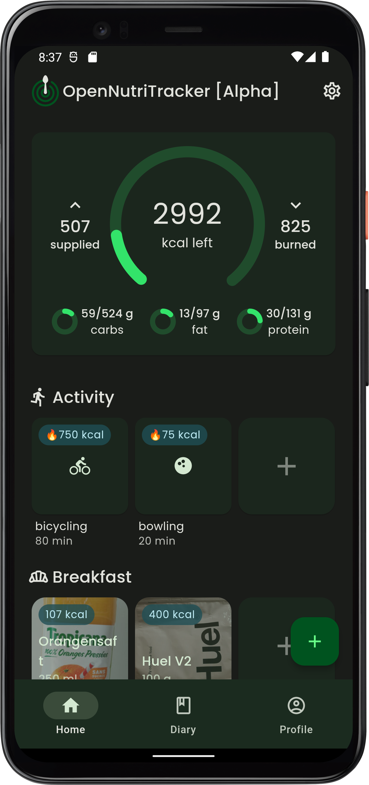
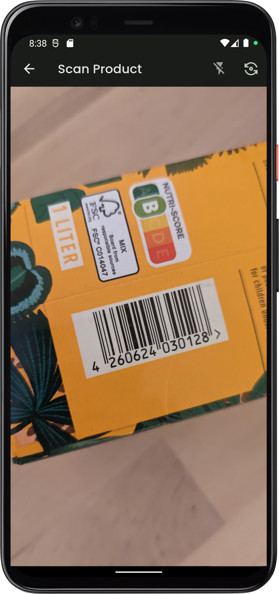
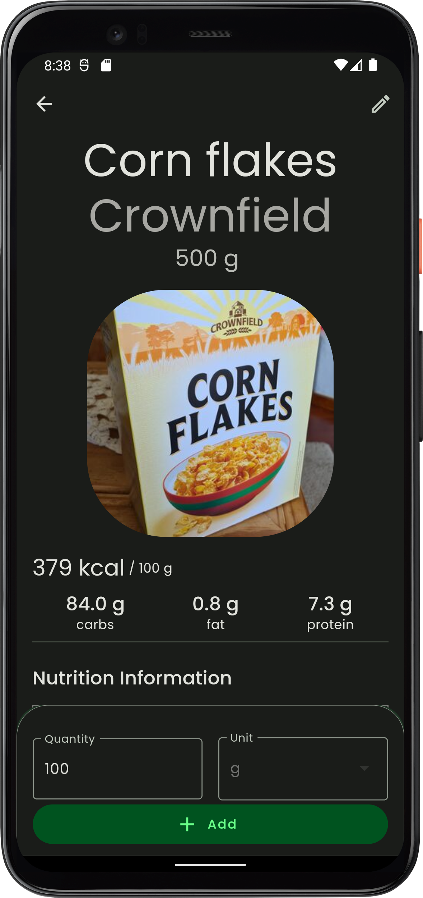
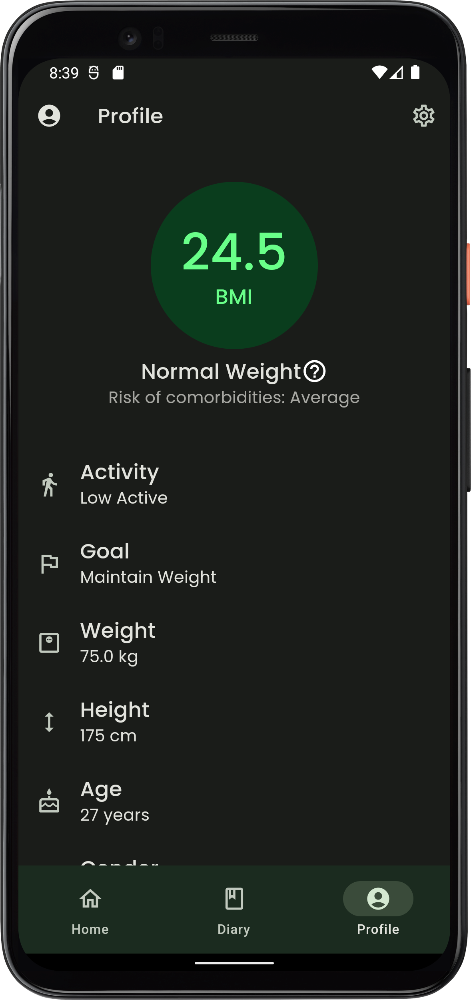

  
  <h1 align="center">AtlasTracker</h1>

  
  
  
  
  

## Description
AtlasTracker is an open-source mobile application designed to simplify nutritional tracking and management. Whether you are looking to improve your health, lose weight, or simply maintain a balanced diet, AtlasTracker provides a minimalistic interface to easily track and analyze your daily nutrition.

[Website](https://simonoppowa.github.io/AtlasTracker-Website/)

## Screenshots

  
  &nbsp;&nbsp;
  
  &nbsp;&nbsp;
  
  &nbsp;&nbsp;
  

## Install

## Key Features
- **🍎 Nutritional Tracking:** Easily log your meals and snacks, and access a vast database of food items and ingredients to get detailed nutritional information.
- **📓 Food Diary:** Maintain a comprehensive food diary to keep track of your daily food consumption, habits, and progress.
- **🍽️ Custom Meals:** Plan your meals in advance, create personalized meal plans, and optimize them according to your dietary goals.
- **📷 Barcode Scanner:** Scan barcodes on packaged food items to instantly retrieve their nutritional information.
- **🔒 Privacy Focused:** AtlasTracker prioritizes the privacy its users. It does not collect or share any personal data without your consent.
- **🚫💰 No Subscription, In-App Purchases, or Ads:** AtlasTracker is completely free to use, without any subscription fees, in-app purchases, or intrusive advertisements.

## Privacy
See [Data Protection](https://www.iubenda.com/privacy-policy/53501884)
- **Data Encryption**: All collected user data is encrypted and stored locally on your device
- **Minimal Data Collection**: AtlasTracker only collects the necessary information required for tracking nutrition and providing personalized insights. Your data will not be shared with third parties without your consent.
- **Open-Source**: AtlasTracker is an open-source application

## TODOs
- Add serving sizes to meals
- ~~Add Imperial unit support~~
- Add support for Material You themes

### Urgent
- Run `supabase/fdc_food_search.sql` in the Supabase SQL editor: the app now calls the `search_fdc_food` RPC, without it generic foods (pomme, pain…) return no results

### Bugs (review of `refactor/ui`)
Critical:
- Coach startup sync pulls students' `tracked_days` / `user_weight` into the coach's own journal: missing `.eq('user_id', uid)` (`startup_remote_sync_service.dart` `_fetchRemoteTrackedDays` / `_fetchRemoteUserWeights`)
- Deletes never reach Supabase (`user_intakes`, `user_recipes`): deleted meals/recipes come back at next startup (needs remote delete or `deleted_at` tombstone)
- Imperial: weight screen shows lbs but `EditableTextWidget` sends the typed value as kg (158 lbs saved as 158 kg); `UnitCalc.kgToLbs` rounds to integer so ±0.1 step is invisible

Sync:
- `syncLocalToRemote` upserts everything without comparing `updated_at`: a stale device overwrites newer edits; recipes get `updated_at = now` and are only pulled when missing locally, so recipe edits never propagate
- `_restoreSupabaseArchiveAtStartup` (`main.dart`) re-runs on every launch when the user has no recipes and overwrites local recipes; redundant with row sync, remove it
- Startup awaits 3–4 Supabase calls before `runApp` with no timeout: stuck on splash with a bad network
- `_syncing` guard drops a push fired during login sync instead of rescheduling it
- Profile edits made offline are reverted by `syncProfileFromSupabase` at next startup
- `updated_at` is client-supplied (no DB trigger); `deleted_at` column unused

Weight / Home:
- "Goal / To goal" uses profile `weightKG`, not a target weight (no target field exists)
- `getWeightsFromPastDays` does one lookup per day: history tab = 7 lookups per entry, "1y/All" chart = 365+ lookups, rerun after each save
- `HomeBloc` awaits `_getCoachName` (2 Supabase queries) on every `LoadItemsEvent`: spinner when offline
- Home weight card uses `getTodayUserWeight`: empty unless weighed in today
- `HomeBloc.updateIntakeItem` picks add/remove from the amount delta, wrong when kcal and macros move in opposite directions; reuse the per-field version from `CalendarDayBloc`
- Weight history dates have no year; step labels `'-0,5'`/`'+0,5'` hardcode the decimal comma

Coach:
- DST: `Duration(days: n)` arithmetic skips/repeats a day (`student_trend_view.dart:50`, `student_macros_page.dart` day navigator, `set_student_macros_page.dart` next day, `diary_table_calendar.dart`); use `DateTime(y, m, d ± n)`
- Trend averages include a partially logged today
- Saving a future-dated macro goal overwrites the current one (upsert on `user_id`)
- Students list pull-to-refresh replaces the list with a spinner and rethrows errors into `onRefresh`
- Students card shows "x / 0 kcal" when `calorieGoal` is missing; `trendVsGoal` reused for "vs previous goal"; `'g'` / `' %'` hardcoded instead of l10n

### Cleanup (~1,400 removable lines)
- Dead: non-compact `IntakeVerticalList` / `IntakeCard` paths, `DayInfoWidget`, `weight_vertical_list`, `weight_card`, `weight_info`, `onWeightItemLongPressed`, `DashboardWidget.dailyStepCount`, student bloc `MacroType`/`TimeRange` events, `AddMacroGoalUsecase.addMacroGoal`, `calculations*` arb keys, `_bodyGoalPlaceholder`
- Duplicates: newest-wins diff ×8 and `_canSync` ×2 in sync services, image-with-placeholder ×3, unit localizing ×3, photo picker ×2, kg→lbs display ×4, `_trendColor` vs `weightTrendColor`, card decoration vs `atlasCardDecoration`, dialog shape ×7 (move to `dialogTheme`), inline `metric()` vs `TrendPillSelector`

## Contribution
Contributions to AtlasTracker are welcome! If you find any issues or have suggestions for new features, please open an issue or submit a pull request. Make sure to follow the project's code style and guidelines.

## Disclaimer
AtlasTracker is not a medical application. All data provided is not validated and should be used with caution. Please maintain a healthy lifestyle and consult a professional if you have any problems. Use during illness, pregnancy or lactation is not recommended.

The application is still under construction. Errors, bugs and crashes might occur.

## Acknowledgments
The AtlasTracker project was inspired by the need for a simple and effective nutrition tracking tool.
The food database used in AtlasTracker is powered by [Open Food Facts](https://world.openfoodfacts.org/) and [Food Data Central](https://fdc.nal.usda.gov/).

## License
This project is licensed under the GNU General Public License v3.0 License. See the [LICENSE](LICENSE) file for more information.

## Contact
For questions, suggestions, or collaborations, feel free to contact the project maintainer:

Simon Oppowa

- GitHub: [@simonoppowa](https://github.com/simonoppowa)
- Email: [AtlasTracker-dev@pm.me](mailto:AtlasTracker-dev@pm.me)
